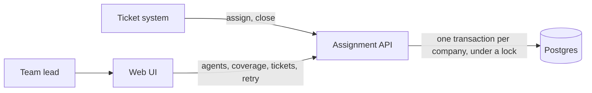

# Technical design: automatic ticket assignment

A ticket system sends a ticket, and the service picks an eligible agent or reports that none is available. A team lead manages shifts, coverage, and unassigned tickets in a small UI. The stack is Node and TypeScript, Express, PostgreSQL, and React.

How the parts connect. Section 2 gives the steps of one assign request.



## 1. Data model

| Table | Columns | Notes |
|---|---|---|
| `companies` | `id`, `name`, `timezone` | `id` comes from the ticket system. `timezone` is seeded. No call edits it. |
| `agents` | `id` PK, `company_id`, `name`, `timezone`, `ticket_limit` | `id` unique across companies, second unique key (`company_id`, `id`). `ticket_limit >= 1`, default 5. |
| `shifts` | `id`, `agent_id` FK, `weekday` 0..6, `start_minute`, `end_minute` | `weekday` 0 is Sunday. Local minutes 0..1439 of the agent. `start != end`. `end < start` wraps midnight and belongs to the start weekday. |
| `coverage_hours` | `id`, `company_id`, `weekday` 0..6, `start_minute`, `end_minute` | Local minutes of the company, `start < end`, end up to 1440. No rows means every hour of every day. |
| `tickets` | `company_id`, `ticket_id`, `status`, `agent_id`, `created_at`, `assigned_at`, `closed_at`, `decision_id` | PK (`company_id`, `ticket_id`). |
| `decisions` | `id`, `company_id`, `ticket_id`, `decided_at`, `outcome`, `reason` | One row per attempt, never updated. `tickets.decision_id` points to the latest. |

Constraints: `status` in `open`, `closed`, `unassigned`; `open` requires `agent_id` and `assigned_at`; `unassigned` requires neither; `closed` requires `closed_at`. `tickets (company_id, agent_id)` references `agents (company_id, id)`, so an agent cannot own a ticket of another company. `created_at` is set on insert and never updated. The service validates `timezone` as an IANA name. Instants are stored as UTC; shift and coverage minutes stay local.

The service does not store an open count or a last assignment. It computes both from `tickets` on each decision, so they cannot go out of date. The open count is the number of the agent's tickets with status `open`. The last assignment is the newest `assigned_at` over all of the agent's tickets, open and closed, so an agent who closed every ticket is not treated as never assigned. Index `tickets (agent_id, status)` serves these reads. Index `tickets (company_id, status, created_at, ticket_id)` serves the unassigned list, oldest first.

`decisions.reason` stores the reason as JSON, in the shape that section 3 shows. It is a copy of the values at decision time, so it stays correct after the counts change. A retry adds a row. A replay adds nothing.

## 2. Assignment logic

The service selects an agent who is on shift and below the ticket limit. Among those agents, it prefers the fewest open tickets, then the oldest last assignment, then the lower agent ID. When open counts are equal, an agent with no assignment goes first.

The steps below make that decision safe when requests arrive together. `POST /api/companies/{company_id}/assignments` runs them in one transaction at READ COMMITTED.

1. **Lock assignments for the company.** Take `pg_advisory_xact_lock(hashtext(company_id))`, so requests for the same company run one at a time. Other companies do not wait. A request waits up to 5 seconds (`SET LOCAL lock_timeout = '5s'`). If the lock is still not free, the request returns 503 with `Retry-After: 1` and changes nothing.
2. **Read the current time after getting the lock.** `now` comes from the application clock. The same value checks the shifts, timestamps the decision, and sets `assigned_at`.
3. **Check for an existing ticket.** If the ticket has an agent, return the saved agent and decision, with `"closed": true` if it is closed. If it is closed without an agent, return `assigned: false` with `TICKET_CLOSED`. These paths write nothing. An `unassigned` or new ticket continues.
4. **Load the agents of the company.** Fetch each agent's shifts, ticket limit, open count, and last assignment time. The last assignment includes tickets that are now closed.
5. **Filter out agents who cannot receive a ticket.** Exclude agents who are off shift at `now` (`NOT_ON_SHIFT`). Then exclude agents whose open count is at or above the ticket limit (`AT_LIMIT`). Record the reason for each.
6. **If no agent is eligible, save the ticket as unassigned.** Record whether nobody is on shift (`NO_AGENT_ON_SHIFT`) or every on-shift agent is at the limit (`ALL_AT_LIMIT`). Insert the `decisions` row. Create or update the ticket as `unassigned` with the new `decision_id` and its original `created_at`. Commit and return `assigned: false`.
7. **Select the agent with the fewest open tickets.** On a tie, select the agent whose last assignment is the oldest. An agent with no assignment goes first. If still tied, use ascending text order of `agent_id`. The seed keeps ids one digit (`a1` to `a5`), so text order matches number order. For each other eligible agent, record the deciding comparison with the compared value: more open tickets (`MORE_OPEN`), a more recent assignment (`ASSIGNED_MORE_RECENTLY`), or a higher id (`HIGHER_ID`).
8. **Save and return the assignment.** Insert the `decisions` row with its reason. Create or update the ticket as `open` with the selected `agent_id`, `assigned_at = now`, and the new `decision_id`. Commit both rows in the same transaction. Return the selected agent and the reason.

**Lock rules.** The one-second target in the PRD applies to a request that does not wait. Close, retry, agent update, and coverage-hours update take the same lock, so a decision never reads a limit, shift, or count mid-change, and an edit applies from the next decision. A hash collision only makes an unrelated company wait. An error before commit rolls back and leaves the ticket row unchanged.

**Replay.** A caller that loses the response resends the same `ticket_id`. An `open` result is replayed. An `unassigned` one is decided again.

**Why raw counts.** The service compares open counts, not open divided by limit. Open count is what the lead sees, and the limit is a ceiling. An agent who starts a shift at zero gets the next tickets until level with the others.

**On shift.** Convert `now` to the agent's timezone, giving weekday `d` and minute `m`. The agent is on shift when one of these holds: a shift on `d` has `start <= m < end`; a shift on `d` wraps and `start <= m`; a shift on `d - 1` wraps and `m < end`. Start is inclusive, end is exclusive. A repeated DST hour is on shift both times. A missing hour never occurs.

## 3. API

Bodies are JSON. Shift and coverage times are local `"HH:MM"`; `"24:00"` is valid only as a coverage end. Other times are ISO 8601 with offset.

| Caller | Call | Effect |
|---|---|---|
| Ticket system | `POST /api/companies/{id}/assignments` | Body `{ "ticket_id" }`. Section 2. |
| Ticket system | `POST /api/companies/{id}/tickets/{ticket_id}/close` | `open` or `unassigned` becomes `closed`, `closed_at = now`, agent kept. Already `closed`: no-op, 200. Unknown: 404. |
| UI | `POST /api/companies/{id}/assignments/retry` | Body `{ "ticket_id" }` or `{ "all": true }`. Tries one unassigned ticket again, or all of them, oldest first. Details are below the table. |
| UI | `GET /api/companies` | Companies. |
| UI | `GET /api/companies/{id}/agents` | Agents with shifts, limit, open count, on-shift flag. |
| UI | `PUT /api/companies/{id}/agents/{agent_id}` | `{ timezone, ticket_limit, shifts: [{ weekday, start, end }] }`. Replaces all three under the lock. |
| UI | `GET /api/companies/{id}/coverage?week=2026-10-12` | Gaps and per-agent intervals for that company-local week. `week` is a Monday. |
| UI | `PUT /api/companies/{id}/coverage-hours` | `{ hours: [{ weekday, start, end }] }`. Empty list restores every hour of every day. Full day is `"00:00"` to `"24:00"`. |
| UI | `GET /api/companies/{id}/tickets?status=unassigned&order=oldest` | Tickets with agent and latest reason. |

**Assign again.** The service reads the list of unassigned tickets one time, oldest first, then by `ticket_id`. It decides each ticket in its own transaction with the steps of section 2, so one failure does not undo the others. The response is 200 with one result per ticket:

- `ASSIGNED`: the ticket now has an agent.
- `UNASSIGNED`: there is still no eligible agent.
- `SKIPPED`: the ticket is already assigned or closed.
- `FAILED`: an error, with its code. An unknown `ticket_id` gives `TICKET_NOT_FOUND`.

Assign response:

```json
{
	"ticket_id": "T-104",
	"assigned": true,
	"agent": { "id": "a2", "name": "Rahul" },
	"decision_id": 318,
	"reason": {
		"rule": "FEWEST_OPEN",
		"selected": { "agent_id": "a2", "open": 2, "limit": 5, "last_assigned_at": "2026-10-13T04:10:00Z" },
		"rejected": [
			{ "agent_id": "a1", "code": "MORE_OPEN", "open": 3 },
			{ "agent_id": "a3", "code": "NOT_ON_SHIFT" },
			{ "agent_id": "a4", "code": "AT_LIMIT", "open": 5 }
		]
	}
}
```

No agent: `"assigned": false`, `"agent": null`, `"selected": null`, rule `NO_AGENT_ON_SHIFT` or `ALL_AT_LIMIT`, full `rejected` list. Closed without agent: rule `TICKET_CLOSED`, no `rejected`.

400 `VALIDATION_ERROR`: `ticket_limit < 1`, unknown IANA timezone, `start == end`, overlapping shifts of one agent (wrap-around included), overlapping coverage ranges on one weekday, a time not on a 5-minute step. Unknown company, agent, or ticket in a path: 404 `COMPANY_NOT_FOUND`, `AGENT_NOT_FOUND`, or `TICKET_NOT_FOUND`. Lock wait over 5 seconds: 503 `LOCK_TIMEOUT`. A successful request returns 200, also when `assigned` is false. An error body is `{ "error": { "code", "message" } }`.

The service assumes the ticket system calls `close`. If the trial supplies status another way, `close` becomes the import point and nothing else changes.

## 4. Coverage

The coverage view answers one question: in this week, when did the company want an agent on shift and have none?

1. **Pick the week.** Monday 00:00 to next Monday 00:00 in the company timezone, as two instants. Across a DST(Daylight Saving Time) change the week is 167 or 169 hours long.
2. **Find the moments where anything can change.** Who is on shift only changes at a shift start, a shift end, a coverage-hour boundary, a clock change, or the week ends. Collect those instants. Shift times are in the agent's timezone. In a repeated DST hour a shift time occurs two times, so both count. In a missing hour it occurs no time. Example: on a spring-forward night a 02:15 to 03:15 shift starts at the 03:00 jump, because 02:15 does not exist.
3. **Walk from one moment to the next.** Nothing changes in between, so ask once per stretch, for each agent: is this agent on shift now? Use the on-shift rule from section 2. Coverage and assignment share that one rule, so they cannot disagree.
4. **Mark the gaps.** A gap is a stretch inside coverage hours where no agent is on shift. Return each gap with its exact start and end, plus each agent's on-shift stretches for the timeline.

No hourly grid. Shifts from 09:00 to 09:30 and from 10:00 to 11:00 give a gap from 09:30 to 10:00.

## 5. Main UI flow

No login. A company selector, then three tabs. The unassigned count sits in the **Tickets** tab label on every page.

1. **Team schedule**: agents with timezone, limit, open count, on-shift dot. Open one, edit timezone, limit, shifts, save. Validation errors inline; a 503 shows "busy, try again".
2. **Coverage**: week picker, one timeline per weekday in the company timezone, one bar per agent, gaps inside coverage hours red, outside grey, a gap list above. Coverage hours are edited here.
3. **Tickets**: agent, time, short reason; filter `unassigned`; order oldest or newest; row click shows the full reason; **Assign again** for one or all; **Close** on an open ticket; a **New ticket** form that calls the assignment endpoint so the flow runs without a terminal.

Manual check against the seed: set an overnight shift, see the Saturday gap, create a ticket with no shift active, **Assign again**, **Close**.

## 6. Expected behavior

Normal cases that the service handles as part of its main flow.

| Topic | When | What the service does |
|---|---|---|
| Local time | A shift is Monday 22:00 to 06:00. A ticket arrives Tuesday 02:00. | The agent is on shift. The shift belongs to Monday and runs past midnight. |
| | A ticket arrives at the exact start or end minute of a shift. | The agent is on shift at the start minute, and not at the end minute. |
| | One agent is in New York and one is in Kolkata. | Each agent is checked in their own timezone. |
| Repeated calls | A ticket that has an agent is sent again. | The same agent and decision come back, and nothing is written. A closed ticket also returns `"closed": true`. |
| | An `unassigned` ticket is sent again. | The service decides again with the current shifts and counts. |
| | A closed ticket is closed again. | Nothing changes. The response is 200. |
| | An `unassigned` ticket is closed. | It becomes `closed` with no agent. A later assign returns `TICKET_CLOSED`. |
| Nobody eligible | No agent is on shift. | The ticket is saved as `unassigned` with `NO_AGENT_ON_SHIFT`. Every agent is in the rejected list. |
| | Every agent on shift is at the limit. | The ticket is saved as `unassigned` with `ALL_AT_LIMIT`. |
| | The company has no agents. | The ticket is saved as `unassigned` with an empty rejected list. The coverage view shows all coverage hours as gaps. |
| Fairness | A new agent starts at zero. The others have three each. | The new agent gets the next three tickets. Then the normal order applies. |
| | Two agents tie on open count and on last assignment time. | The lower `agent_id` wins. The other agent gets `HIGHER_ID`. |
| Schedule edits | The lead deletes a shift, or lowers a limit below the open count. | Open tickets stay with the agent. New tickets come only in the remaining shifts, and only when the count is below the limit. |
| | The lead saves an edit while a decision runs. | The edit waits, then applies from the next decision. |

## 7. Edge cases

Rare cases with a defined rule.

| Topic | When | What the service does |
|---|---|---|
| Same instant | Two calls for the same new ticket arrive together. | They run one at a time. If the first assigns an agent, the second returns the same agent. |
| | Twenty tickets arrive together. Three agents are on shift at zero, with a limit of 5. | Fifteen tickets are assigned, five per agent. Five are saved as `unassigned`. |
| | A request arrives at 16:59:58 and gets the lock at 17:00:01. | The time is read after the lock, so an agent whose shift ended at 17:00 is not selected. |
| Lock wait | A request waits more than 5 seconds for the lock. | Nothing is written. The response is 503 with `Retry-After: 1`. |
| | One ticket times out in an **Assign again** for all. | Only that ticket is reported as failed. The others keep their results. |
| Daylight saving | The clocks go forward. A shift is 01:00 to 03:00. | The hour 02:00 to 03:00 does not occur, so the agent is on shift for one real hour. Coverage shows one interval. |
| | The clocks go forward. A shift is 02:15 to 03:15. | The time 02:15 does not occur, so the shift starts at 03:00. |
| | The clocks go back. A shift is 01:15 to 01:45. | The hour 01:00 to 02:00 occurs two times, so the agent is on shift two times. Coverage shows two intervals with different UTC offsets. |

## 8. Test plan

Rule tests call the `domain/` functions with an injected clock and no database.

- On shift at the exact start and end, across midnight, and inside the missing and the repeated hour for `America/New_York` and `Europe/London`.
- Selection: fewest open, then oldest `last_assigned_at` with never-assigned first, then id. Every rejected code with its compared value.
- Coverage: one gap, no gap, no agents, overlapping shifts counted once, a shift start in a 45-minute-offset timezone ending a gap at the exact instant, and the two DST shifts of section 7 with week lengths of 167 and 169 hours.

API tests run against PostgreSQL with a dedicated fixture per test.

- Every row of sections 6 and 7 that touches the API, every validation error in section 3, and tenant isolation (`T-1` in company A and in B are independent rows).
- Concurrency: 20 assigns with 3 on-shift agents at zero give 15 `open`, 5 `unassigned`, 20 `decisions` rows; 10 assigns for one new ticket give one ticket row and one decision. Lock order with barriers, close then assign and the reverse, asserts the second transaction saw the first commit.
- Retry-all with one forced timeout: the others succeed, the response names the failure, `created_at` is unchanged. One timed test: an eligible assignment on the seed returns in under one second.

UI tests run against a mock of the API: the API client, the reason sentences, and one flow per tab. Seed: two companies, five agents each across three timezones, a Saturday gap, three open tickets. `npm run seed` loads it. `npm test` in `server/` and in `web/` run the suites.
